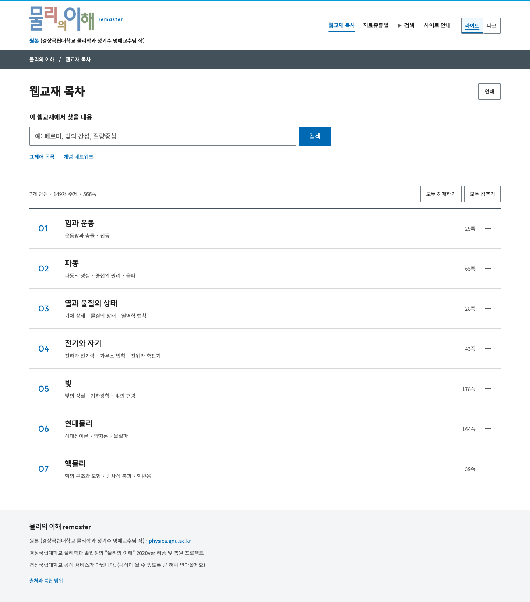

# GNU·KRDS 탐색 개선

2026-11-02. [GNU template](https://github.com/Gahyoun/gnu-network-science-skills/tree/main/templates/gnu-template)의 정보 안내형 구성을 적용했다. 기존 교재의 내용과 주소를 유지하면서 홈 탐색과 공통 헤더를 정리한 변경이다.

## 바뀐 동작

- 홈의 반복 사이드바를 줄이고 검색과 7개 단원 목차를 단일 본문에 배치한다. 교재 페이지에서는 현재 단원의 읽기 맥락과 모바일 목차를 유지한다.
- 홈 검색은 `search.html?q=…`로 연결되는 GET 폼이다. 기존 검색 엔진과 공유 가능한 검색 주소를 그대로 사용한다.
- 7개 단원은 동일한 닫힌 상태에서 시작하며 번호·제목·실제 중분류·쪽수·펼침 표식을 분리한다. 전체 전개/감추기와 `#chapter-N` 직접 이동도 동작한다.
- 상세 목차의 566개 페이지 링크를 보존하고 개별 페이지 링크의 시각적 강조를 낮춘다. 터치 영역은 44px 이상으로 유지한다.
- 원본 로고와 정기수 명예교수님 표기, 원본 링크, 라이트/다크, 인쇄 기능을 유지한다. 사진 배너·캐릭터·광고 문구는 추가하지 않는다.

공통 탐색은 `tools/build.mjs`, 홈 목차는 `tools/navigation-build.mjs`, 새 레이아웃은 `assets/site-layout.css`에서 편집한다. 생성된 HTML만 직접 고치면 다음 빌드 때 사라진다. 기존 `assets/style.css`와 학습 내용·물리 모형은 변경하지 않았다.

## 디자인과 화면

[Figma 파일](https://www.figma.com/design/ZQ8XuKy3TPP6T2DVrQVcIL?node-id=8-138)에는 데스크톱 1440px, 모바일 390px, 펼친 단원 시안이 있다. 텍스트와 행 구조는 편집 가능한 레이어이며, GNU 템플릿 색상 변수와 라이브러리 버튼을 사용한다. 웹 구현은 기존 로컬 Noto Sans KR·SUITE 서체를 유지한다.

Figma 마감에서는 원본 로고의 글자를 보존하면서 표시 여백과 크기를 보완하고, 검색 영역·통계 위치를 웹 구현에 맞췄다. 모바일의 전체 전개/감추기 버튼을 별도 행으로 정리했으며 세 가지 화면을 PNG로 내보내 배치를 확인했다.

가시성·접근성 보완에서는 14px 보조 글자, 선명한 조작 경계와 키보드 포커스, 링크·선택 상태의 밑줄, 모바일 설명 줄바꿈과 검색 메뉴 넘침을 반영했다. [변경과 검증 범위](accessibility-improvements.md)에 세부 사항을 기록했다.

[데스크톱 시안 PNG](images/figma-desktop.png) · [모바일 시안 PNG](images/figma-mobile.png) · [펼친 목차 시안 PNG](images/figma-expanded.png)

실제 HTML 구현 화면:



[모바일 화면](images/navigation-390.png) · [다크 화면](images/navigation-dark-1440.png) · [키보드 포커스](images/navigation-focus-390.png)

## 검증

| 범위 | 결과 |
|---|---|
| 홈·탐색 | 320·390·768·1360·1440px에서 가로 넘침 없이 번호·제목·쪽수 분리 |
| 상호작용 | 전체 전개/감추기, 키보드 Enter, 교재 링크, 모바일 목차·Esc·포커스, 실제 GET 검색 |
| 환경 | 테마 저장, 밝은 인쇄, CSS 200%·400% 확대와 320px 재배치, 본문 바로가기, JavaScript 없는 목차·수식 |
| 수식 화면 | 571페이지 × 3개 폭 = 1,713건 통과; 새 CSS 로드와 검사 전후 소스 해시 확인 |
| 관련 단위검사 | catalog-links·book·math-format 13개 통과 |
| 전체 단위검사 | 680개 + 수식 보고서 의존성 확인 3개 통과, 실패·건너뜀 0개 |
| 접근성 집중 검사 | 밝음·어두움 × 4개 폭 및 간격·포커스·확대 등 12항목 통과 |
| 기존 종합 브라우저 검사 | 17페이지·4개 폭·상호작용 135건, 오류·외부 요청 0건 |

[탐색 검사 기록](navigation-layout-report.json), [수식 화면 기록](math-ui-report.json), [수식 검증 범위](math-rendering-audit.md)에 실제 실행 근거를 남겼다. 이번 기록은 애니메이션의 모든 입력 조합을 새로 검증했다는 의미가 아니다.

로컬 서버를 실행한 뒤 Playwright와 Chrome이 있는 환경에서 확인한다. `PHYSICA_PLAYWRIGHT`는 프로젝트 밖에 설치한 Playwright 모듈 경로를 사용할 때만 지정한다.

```sh
node tools/build.mjs
node --test tools/catalog-links.test.mjs tools/book.test.mjs tools/math-format.test.mjs
python3 -m http.server 8775 --bind 127.0.0.1
# 별도 터미널
PHYSICA_BASE_URL=http://127.0.0.1:8775/ PHYSICA_BROWSER_CHANNEL=chrome node tools/site-layout-check.mjs
```

배포는 저장소의 기존 GitHub Pages 절차를 따른다. 수정안 검토 후 `main`에 병합하면 기존 게시 워크플로가 실행된다.
